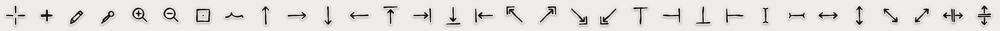

# Claude Cursors

An animated Linux cursor theme made from the Claude logo. The pointer is the Claude spark, and each of its 12 legs stretches and sways on its own. Hovering a link folds the spark into a solid teardrop pointer. Busy cursors play the Claude Duet mascot, and the help, copy, link, and menu badges use Duet's ink line to draw their symbol.


## What's in it

| Cursor | Looks like |
| --- | --- |
| Pointer | The Claude spark. The click point is the center of the spark. |
| Moving a window | The same spark with shorter legs. The center stays put. |
| Link / button hover | The spark's legs curve down-right and fold into a solid orange teardrop in about 0.3 s. The teardrop's tip is the click point. |
| Busy | A smaller teardrop with Duet's ink ring orbiting its body, passing behind it on the far side. The full wait cursor is the Duet mascot alone. |
| Help, copy, link, menu, not allowed | The teardrop with Duet's ink line writing the symbol inside its body, holding it, and writing it again. |
| Text caret, resize arrows | Hand-drawn black ink with a cream edge so it shows on dark windows. |




It also draws every other standard cursor in the same style: crosshair, pencil, color picker, zoom, edge and corner resize, plain arrows, and drag-and-drop states in ink or with Duet badges. Hovering something draggable spreads the spark's legs fully out, and the pirate (kill) cursor is a red spark.

## Install

1. Download `claude-cursors.tar.xz` from the [latest release](../../releases/latest).
2. Extract it into `~/.icons`:

   ```sh
   mkdir -p ~/.icons
   tar xJf claude-cursors.tar.xz -C ~/.icons
   ```

3. Pick it:
   - KDE Plasma: System Settings → Colors & Themes → Cursors → Claude Cursors, or run `plasma-apply-cursortheme claude-cursors`.
   - GNOME: `gsettings set org.gnome.desktop.interface cursor-theme claude-cursors`

It includes 11 sizes, from 12 px to 72 px, so the size setting and display scaling both stay sharp. Like Breeze, each size is drawn 25% larger than its number, so at your usual size setting it looks as big as other themes. Installed, it takes about 230 MB because nearly every cursor is animated at every size.

## Build it yourself

You need Python 3 with `pycairo` and `Pillow`.

```sh
python3 build.py ~/.icons/claude-cursors
```

Options:

- `--inherits THEME` sets the theme that supplies the cursors this one doesn't draw. The default is `breeze_cursors`.
- `--preview DIR` writes pointer and grab GIFs to `DIR`.

Values you can change at the top of `build.py`:

- `STRETCH`, `FLICKER`, and `SWAY_DEG` set how much the legs move.
- `GRAB_SCALE` sets how short the legs get while you move a window.
- `DELAY_MS` sets the frame length, which sets the animation speed.
- `SIZES` lists the cursor sizes to build. Removing sizes you don't use makes the theme smaller.

## How it works

- `spark_logo.py` turns the logo outline into a polygon and finds its 12 legs. Each frame stretches and rotates every leg's points past the hub, so with every leg at rest the outline is the logo exactly.
- `duet.py` draws the Duet mascot: the ink brush, the blob, and the ring orbiting it. It also draws the symbol badges.
- `ink_symbols.py` draws the caret and arrows with the same brush.
- `build.py` renders every frame with cairo and writes standard animated Xcursor files.
- `make_docs.py` renders the preview GIFs in `docs/`.

## Credits

This is an unofficial fan project, not affiliated with or endorsed by Anthropic. Claude, the Claude logo, and Claude Duet belong to Anthropic. The logo outline comes from the Claude desktop app. The mascot's brush and poses follow the Claude desktop app and the Claude Duet demo on claude.com.
